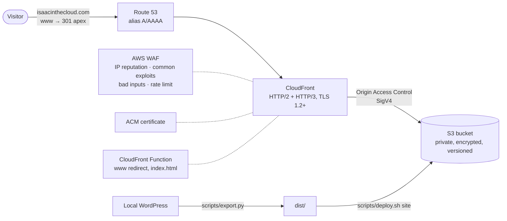

# isaacinthecloud-site-infra

Infrastructure as code for **[isaacinthecloud.com](https://isaacinthecloud.com)**, my portfolio site.

I design and edit the site in WordPress on my laptop, then export it to static files and serve them from AWS. The public site has no PHP, no database and no admin login, so there's nothing to patch or break in, and it costs **$0/month** on CloudFront's flat-rate Free plan.

## Architecture



Everything is one CloudFormation stack: [`template.yaml`](template.yaml).

| Resource | Why |
|---|---|
| S3 bucket | Private, all public access blocked, SSE, bucket-owner-enforced, TLS-only policy. Versioned so a bad deploy can be rolled back; old versions expire after 30 days. Retained if the stack is deleted. |
| CloudFront + Origin Access Control | The only thing that can read the bucket (bucket policy pinned to this distribution's ARN). HTTP/2 and HTTP/3, IPv6, Brotli/gzip, AWS-managed caching and security-header policies, custom 404. |
| ACM certificate | Apex + www, ECDSA P-256, DNS-validated automatically through Route 53. |
| CloudFront Function | 301s `www.` to the apex and maps `/path/` to `/path/index.html` at the edge. |
| AWS WAF | Amazon IP reputation list, Core rule set, Known bad inputs, and a per-IP rate limit. Blocked requests don't count against the plan's allowance. |
| Flat-rate Free plan | `AWS::PricingPlanManager::Subscription`. Flat $0: no overage charges, ever; sustained traffic past the allowance gets throttled rather than billed. |
| Route 53 records | Alias A/AAAA for apex and www. The zone's mail and verification records are left alone. |
| AWS Budget | Emails me at 50% of actual and 100% of forecast spend for resources tagged with this project. |
| Deploy policy | Least-privilege IAM policy with exactly what `deploy.sh site` needs (sync this bucket, invalidate this distribution). |

## Cost

| Item | Monthly |
|---|---|
| CloudFront, WAF, ACM, CloudFront Function, S3 (≤5 GB) | **$0**, covered by the Free plan |
| Route 53 hosted zone | $0.50 if the zone isn't attached to the plan (it can be, with ≤50 records) |
| Budget alerts | $0 |

Free plan allowances: 1M requests and 100 GB transfer per month. These are guardrails, not a bill: there are no overage charges, and I get emailed if anything tagged for this project costs money anyway.

Limits that shaped the template: the distribution must use all edge locations (`PriceClass_All`; anything narrower is rejected as "not eligible for this subscription tier"), at most 5 WAF rules and no custom rule groups, only AWS-managed cache and response-header policies, no Lambda@Edge or real-time logs, and edge functions can't be shared with other distributions.

## Deploy

Requirements: AWS CLI v2 with credentials (`aws login`), Python 3.10+, and the WordPress site running locally.

```bash
cp deploy.env.example deploy.env   # domain, hosted zone ID, alert email, local site URL

scripts/deploy.sh plan     # change set preview, no changes made
scripts/deploy.sh infra    # create or update the stack (first run ~5–10 min for the certificate + CloudFront)
scripts/deploy.sh site     # export, upload, invalidate
```

The budget filters on the `Project` tag, so activate it once as a cost allocation tag after the first deploy (Billing → Cost allocation tags, or `aws ce update-cost-allocation-tags-status`).

### How the export works

[`scripts/export.py`](scripts/export.py) (standard library only) crawls the local site from its home page and follows same-origin links and assets: `href`, `src`, `srcset`, CSS `url()`, and absolute URLs inside meta tags and JSON-LD. It then:

- rewrites the local origin to `https://isaacinthecloud.com`, including JSON-escaped and protocol-relative forms,
- saves WordPress's 404 page as `404.html` and writes `robots.txt` and `sitemap.xml`,
- skips `wp-admin`, `wp-json`, `xmlrpc.php` and feeds,
- fails if any file still references the local origin.

`deploy.sh site` uploads assets with a 1-day `Cache-Control` and pages with `max-age=0, must-revalidate`, then invalidates CloudFront so changes show up right away.

## Validation

```bash
cfn-lint template.yaml
```

## License

[MIT](LICENSE)
